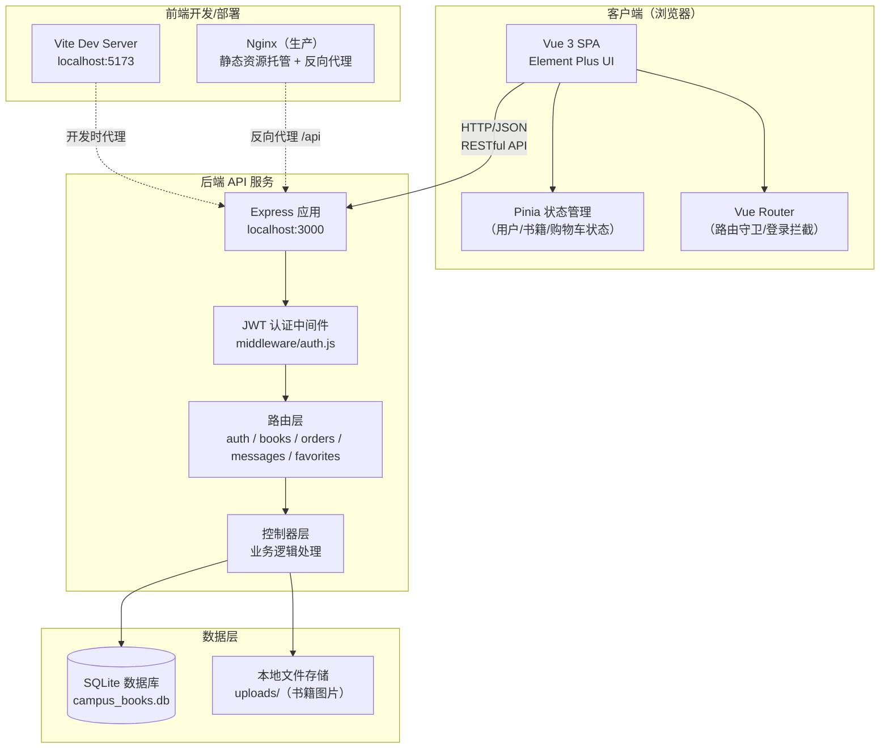
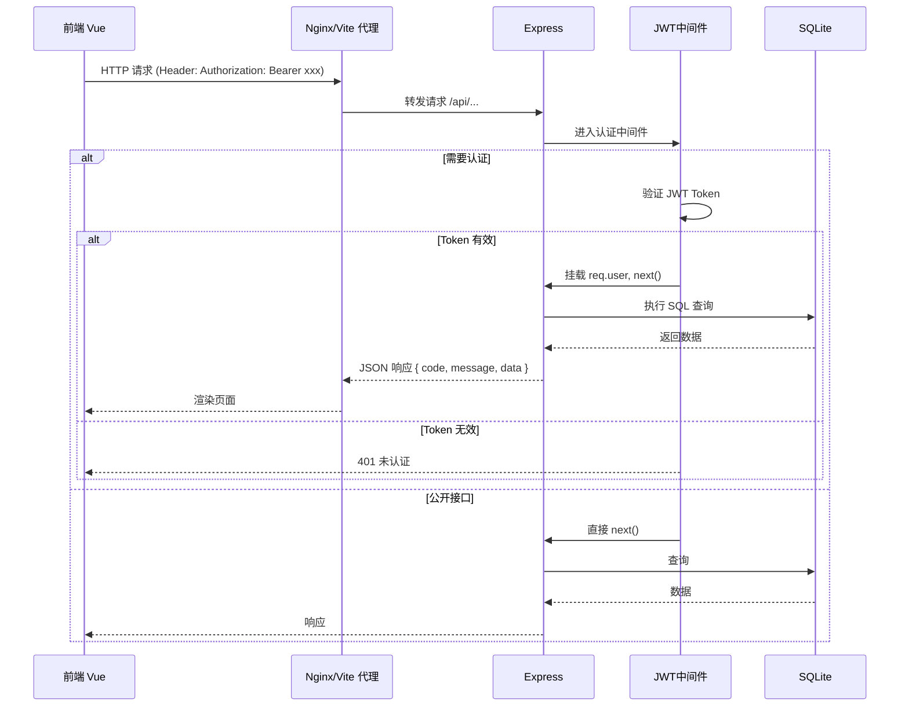
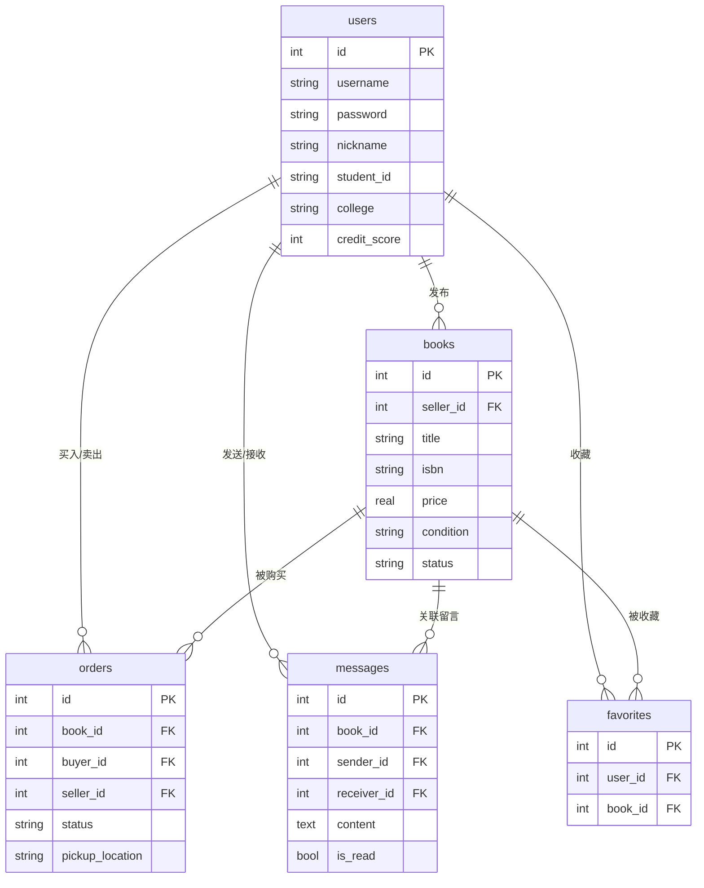

# 校园二手书交易平台 — 项目介绍文档

## 一、项目背景与意义

### 1.1 校园二手书交易的现状与痛点

在大学校园中，教材和教辅书籍是学生每学期的大额支出之一。一门专业课的教材原价通常在 50~150 元之间，一学期下来教材费用可达数百元。然而这些书籍在课程结束后往往被束之高阁，毕业时大量书籍只能当作废品低价处理。与此同时，低年级学生又需要花费高价购买同样的教材。这种"一买一卖"之间的断裂，造成了资源的巨大浪费。

当前校园二手书交易主要依赖以下渠道，但均存在明显不足：

| 现有渠道 | 存在问题 |
|---------|---------|
| 班级群/朋友圈 | 信息零散、时效性差、无法搜索、无交易保障 |
| 闲鱼等综合二手平台 | 面向全社会、物流成本高、无法线下自提、信息不精准 |
| 校园二手书群 | 群消息刷屏、书籍信息不规范、无分类检索 |
| 毕业季地摊 | 时间集中、覆盖面有限、书籍种类受限 |

核心痛点可归纳为三点：

1. **教材贵**：新生每学期教材支出高，家庭经济压力大；
2. **毕业处理难**：毕业生离校前书籍处理渠道有限，大量书籍被当废品变卖，价值被严重低估；
3. **信息不对称**：买家不知道谁在卖自己需要的书，卖家不知道谁需要自己手里的书，缺乏一个精准连接供需的平台。

### 1.2 项目意义

本项目旨在构建一个**专注于校园场景**的二手书交易平台，通过线上信息聚合 + 线下自提的模式，解决上述痛点：

- **经济价值**：帮助学生以更低成本获取教材，帮助毕业生将闲置书籍变现，减少教育支出浪费；
- **环保价值**：促进书籍循环利用，减少纸张消耗，符合绿色低碳理念；
- **社交价值**：基于校园场景的交易天然具备信任基础，同校学生线下自提可建立更可靠的交易关系；
- **教育价值**：作为大学课程期末项目，完整实践前后端分离开发流程，锻炼团队协作与工程能力。

---

## 二、平台定位与目标用户

### 2.1 平台定位

**校园二手书交易平台**是一个面向高校学生的垂直二手书籍交易 Web 应用。平台不涉足物流与支付担保，而是聚焦于**信息撮合 + 校园内自提**的轻量交易模式：

- 卖家在线发布书籍信息，标注成色与价格；
- 买家浏览、搜索、筛选书籍，通过站内消息联系卖家；
- 双方约定校内自提点当面交易；
- 交易完成后双方可进行信用评价。

平台的核心价值主张：**让每一本闲置教材在校园内找到下一位需要它的人。**

### 2.2 目标用户

| 用户群体 | 核心需求 |
|---------|---------|
| 低年级学生（买家） | 低价购买教材/教辅，精准找到本课程所需书籍 |
| 高年级学生/毕业生（卖家） | 便捷发布闲置书籍，快速变现 |
| 考研/考证学生 | 购买考试类资料，出售用完的复习资料 |
| 文学/课外书爱好者 | 交换、购买课外读物，丰富阅读生活 |

---

## 三、核心功能模块说明

### 3.1 用户系统

- **注册/登录**：基于学号 + 用户名注册，JWT Token 无状态认证；
- **个人资料**：昵称、学院、手机号、头像管理；
- **信用分体系**：新用户默认 100 分，交易完成后可根据评价增减信用分，信用分展示在个人主页；
- **我的发布**：查看自己发布的所有书籍及其状态（在售/已预订/已售出）。

### 3.2 书籍发布

- **多字段发布表单**：书名、作者、ISBN、价格、原价、成色、分类、关联课程、描述、图片上传；
- **图片上传**：使用 Multer 处理本地文件上传，支持多张书籍实拍图；
- **状态管理**：卖家可将书籍标记为"在售/已预订/已售出"。

### 3.3 浏览与搜索

- **书籍列表**：分页展示在售书籍，支持多种排序（价格升/降、最新发布、最热门）；
- **多维度筛选**：按分类（教材/教辅/文学/科技/考试/其他）、成色、价格区间筛选；
- **关键词搜索**：支持按书名、作者、ISBN 模糊搜索；
- **书籍详情页**：展示书籍完整信息、卖家信息、浏览量、收藏数。

### 3.4 交易系统

- **发起订单**：买家在书籍详情页点击"想要"，填写自提点，创建待确认订单；
- **订单状态流转**：`pending（待卖家确认）→ confirmed（已确认）→ completed（交易完成）`，支持取消；
- **买卖双方视图**：买家查看"我买到的"，卖家查看"我卖出的"；
- **自提点约定**：订单中记录校内自提地点（如图书馆门口、宿舍区楼下、食堂门口等）。

### 3.5 订单管理

- 订单列表按角色（买家/卖家）和状态筛选；
- 订单详情展示书籍信息、对方联系方式、约定自提点；
- 交易完成后书籍状态自动变为"已售出"。

### 3.6 站内消息

- 买卖双方可通过站内留言沟通书籍细节、交易时间等；
- 消息按书籍维度组织，便于上下文查看；
- 未读消息红点提示，支持标记已读。

### 3.7 收藏

- 用户可收藏感兴趣的书籍，方便后续查看；
- 收藏列表独立页面管理；
- 书籍详情页显示当前收藏数。

---

## 四、创新亮点

### 亮点一：ISBN 一键识别填单

发布书籍时，用户只需输入 ISBN 号，系统即可调用豆瓣读书 API（或本地预置图书数据库）自动填充书名、作者、封面图等信息，卖家只需补充价格、成色、描述即可完成发布。大幅降低发布门槛，提高书籍信息标准化程度。

### 亮点二：课程关联与智能推荐

每本教材可关联具体课程（如"数据结构""高等数学A"），系统根据用户所在学院和历史浏览/收藏行为，在首页推荐"你所在学院可能需要的教材"。例如，计算机学院的学生打开平台，首页优先展示数据结构、操作系统等课程相关的二手教材，实现**人书精准匹配**。

### 亮点三：信用评价与成色可视化体系

- **信用分**：新用户 100 分起步，每笔完成的交易双方互评，好评加分、差评扣分，信用分在用户主页醒目展示，降低交易信任成本；
- **成色可视化**：成色选项（全新/九成新/八成新/七成新/有破损）配以直观的图标和颜色标签，买家在列表页即可快速判断书籍新旧程度，减少预期偏差。

### 亮点四：校内自提点地图化

平台预设校内常用自提点（图书馆、各宿舍区、食堂门口等），买卖双方在线约定自提点，无需复杂物流。订单中自动记录自提位置，交易流程轻量高效，非常适合校园封闭场景。

---

## 五、技术架构说明

### 5.1 总体架构

项目采用**前后端分离**架构：

- **前端**：Vue 3 + Vite + Element Plus + Pinia + Vue Router，单页应用（SPA）；
- **后端**：Node.js + Express，提供 RESTful API；
- **数据库**：SQLite（通过 better-sqlite3 驱动），轻量级嵌入式数据库，零配置部署；
- **认证**：JWT（JSON Web Token），无状态认证，前后端解耦。

### 5.2 技术选型理由

| 层次 | 技术 | 选型理由 |
|------|------|---------|
| 前端框架 | Vue 3 | 组合式 API 灵活，生态成熟，学习曲线平缓 |
| 构建工具 | Vite | 冷启动快、HMR 秒级反馈，开发效率高 |
| UI 组件库 | Element Plus | 企业级组件丰富，表格/表单/弹窗开箱即用，适合管理类应用 |
| 状态管理 | Pinia | Vue 3 官方推荐，TypeScript 友好，API 简洁 |
| 路由 | Vue Router 4 | 官方路由，支持导航守卫实现登录拦截 |
| 后端框架 | Express | 轻量灵活，中间件生态丰富，Node.js 事实标准 |
| 数据库 | SQLite + better-sqlite3 | 零配置、单文件部署、性能优秀，课程项目无需复杂运维 |
| 认证 | JWT (jsonwebtoken) | 无状态、跨域友好，前后端分离标配 |
| 密码加密 | bcryptjs | 业界标准哈希算法，安全存储用户密码 |
| 文件上传 | Multer | Express 生态标准文件上传中间件 |
| 跨域 | CORS | 开发环境前后端分离必备 |

### 5.3 系统架构图



### 5.4 请求流转流程



---

## 六、数据库概览

数据库共 5 张核心表，关系如下：



---

## 七、项目目录结构总览

```
campus-books-market/
├── backend/                 # 后端服务
│   ├── config/              # 配置（数据库连接等）
│   │   └── database.js
│   ├── database/            # 数据库脚本
│   │   ├── schema.sql       # 建表语句
│   │   └── seed.js          # 种子数据
│   ├── middleware/          # 中间件
│   │   └── auth.js          # JWT 认证
│   ├── routes/              # 路由模块
│   ├── controllers/         # 控制器
│   ├── uploads/             # 上传图片目录
│   ├── data/                # SQLite 数据库文件
│   ├── server.js            # 入口文件
│   └── package.json
├── frontend/                # 前端应用
│   ├── src/
│   │   ├── views/           # 页面组件
│   │   ├── components/      # 公共组件
│   │   ├── stores/          # Pinia 状态
│   │   ├── router/          # 路由配置
│   │   ├── api/             # API 请求封装
│   │   └── App.vue
│   ├── vite.config.js
│   └── package.json
├── docs/                    # 项目文档
│   ├── PROJECT_INTRO.md     # 项目介绍（本文档）
│   ├── API_SPEC.md          # API 规范
│   ├── AI_CONVERSATION.md   # AI 辅助开发对话记录
│   ├── TEAM_CONTRIBUTION.md # 团队分工与贡献度
│   ├── DEPLOYMENT.md        # 部署指南
│   └── VIDEO_SCRIPT.md      # 演示视频脚本
└── README.md                # 项目根 README
```

---

## 八、相关文档索引

| 文档 | 说明 |
|------|------|
| [API 规范文档](./API_SPEC.md) | 前后端接口契约，包含数据模型与全部 API 定义 |
| [AI 辅助开发对话记录](./AI_CONVERSATION.md) | 开发过程中与 AI 工具的对话摘要 |
| [团队分工与贡献度](./TEAM_CONTRIBUTION.md) | 小组成员职责划分与贡献占比 |
| [部署指南](./DEPLOYMENT.md) | 本地开发与生产环境部署步骤 |
| [演示视频脚本](./VIDEO_SCRIPT.md) | 期末答辩演示视频的分镜脚本 |
